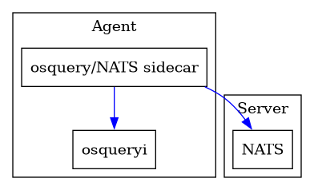

# osquery-nats-agent

An agent written in Go that:

- Reads SQL queries from NATS subjects and/or files
- Executes SQL queries via `osqueryi`; and
- Writes the results to NATS subjects and/or files



## Features

- Configure the agent with a JSON or YAML file
- Read SQL queries from NATS subjects and/or files
- Write query results to NATS subjects and/or files
- Execute SQL queries on an interval (e.g. every second, minute, or hour)
- Dynamically partition NATS subject names<sub>2</sub> and input/output file paths using Jinja2 template strings and automatically injected template variables (e.g. to read from and write to one NATS subject per OS type, or one output file per date and IP address)

<sub>2. Subjects are created by NATS as soon as they're written to.</sub>

## Design

- Scheduled queries are performed differentially by default - i.e. the previous query results are subtracted from the current query results to determine what's changed. Set `snapshot: true` in the configuration file to return the full resultset of each query instead

## Caveats

- Some osquery tables are only accessible by privileged users.
- The project is under active development, does not have a stable API, and is subject to change significantly at any time.

## Example use cases

| Name | Description |
|------|-------------|
| Distributed process monitoring | Track metadata of running processes, including process image metadata (e.g. the MD5, SHA-1, and SHA-256 hash of the file). |
| Distributed file integrity monitoring | Watch file and/or directories for changes. The level of granularity is configured using user defined SQL queries (i.e. you could include file checksums, MACb timestamps, permissions, etc.). |

## Goals

- Simplify the process of performing distributed event tracing across multiple endpoints - particularly in environments without administrative privileges and in ephemeral environments where endpoints may frequently appear and disappear

## Usage

### Building the agent

To statically compile the agent for Windows, Linux, and macOS:

```sh
make build
```

Or, equivalently:

```sh
mkdir -p bin/
CGO_ENABLED=0 GOOS=linux GOARCH=amd64 go build -ldflags="-s -w" -o bin/osquery-nats-agent-linux-amd64 ./cmd/agent
CGO_ENABLED=0 GOOS=darwin GOARCH=arm64 go build -ldflags="-s -w" -o bin/osquery-nats-agent-darwin-arm64 ./cmd/agent
CGO_ENABLED=0 GOOS=windows GOARCH=amd64 go build -ldflags="-s -w" -o bin/osquery-nats-agent-windows-amd64.exe ./cmd/agent
```

The following statically compiled binaries will be created in the `bin/` directory:

| Path | OS type | OS architecture |
|------|---------|----------------|
| `bin/osquery-nats-agent-windows-amd64.exe` | Windows | amd64 |
| `bin/osquery-nats-agent-linux-amd64` | Linux | amd64 |
| `bin/osquery-nats-agent-darwin-arm64` | macOS | arm64 |

### Running the agent

The agent needs a configuration file, passed with `-config`; `config.json` below stands for yours. See [agent configuration](docs/agent-configuration.md) for the options, and [`examples/config/`](examples/config/) for configurations to start from.

If running from source:

```sh
go run ./cmd/agent -config config.json
```

If using a compiled binary:

```sh
./bin/osquery-nats-agent-linux-amd64 -config config.json
./bin/osquery-nats-agent-darwin-arm64 -config config.json
./bin/osquery-nats-agent-windows-amd64.exe -config config.json
```

To enable debug logging, add the `-debug` flag when running the agent:

```sh
go run ./cmd/agent/main.go -config examples/config/files/processes.yaml -debug
```

```sh
go run ./cmd/agent/main.go -config examples/config/files/processes.yaml -debug
```
